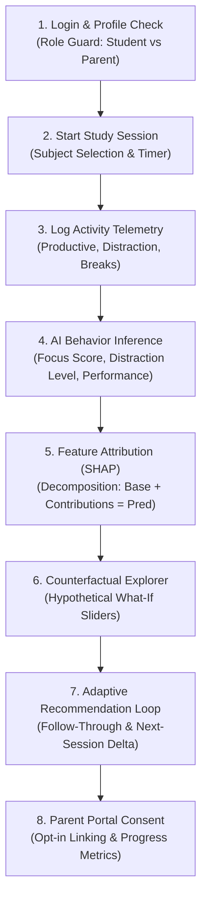

# FocusSense AI — End-to-End Live Demonstration Walkthrough

This document provides a verified, step-by-step demonstration walkthrough for **FocusSense AI**. It guides evaluators, faculty, and engineers through the complete end-to-end workflow: authentication, study sessions, real-time telemetry logging, machine learning inferences, feature attribution explainability, interactive counterfactual simulations, closed-loop adaptive recommendations, and the student-consented parent portal.

---

## 1. Prerequisites & Environment Setup

### System Requirements
- **Operating System:** Windows 10/11, macOS, or Linux
- **Python:** Python 3.11+ (tested on Python 3.14.7 virtual environment in `backend/.venv`)
- **Node.js:** Node 18+ or 20+ with npm (`frontend/package.json`)
- **Database:** Supabase PostgreSQL instance (or local SQLite for test harness)

### Configuration Verification
Confirm the existence of environment files before launching:
- **Backend:** `backend/.env` with `SUPABASE_URL`, `SUPABASE_ANON_KEY`, `SUPABASE_SERVICE_ROLE_KEY`, and `DATABASE_URL`.
- **Frontend:** `frontend/.env.local` (or `frontend/.env`) with `VITE_SUPABASE_URL` and `VITE_SUPABASE_ANON_KEY`.

---

## 2. Verified Service Startup Commands

Run the backend and frontend in separate terminals from the project root (`C:\Users\likhi\FocusSenseAI`):

### Terminal 1: FastAPI Backend Service
```powershell
# Navigate to backend
cd C:\Users\likhi\FocusSenseAI\backend

# Activate virtual environment and start FastAPI
.\.venv\Scripts\Activate.ps1
uvicorn app.main:app --host 127.0.0.1 --port 8000 --reload
```
*Expected Output:*
```text
INFO:     Started server process
INFO:     Waiting for application startup.
INFO:     Application startup complete.
INFO:     Uvicorn running on http://127.0.0.1:8000 (Press CTRL+C to quit)
```
- Interactive OpenAPI Swagger Documentation: [http://127.0.0.1:8000/docs](http://127.0.0.1:8000/docs)
- Health Check Endpoint: [http://127.0.0.1:8000/api/v1/health](http://127.0.0.1:8000/api/v1/health)

### Terminal 2: React / Vite Frontend Application
```powershell
# Navigate to frontend
cd C:\Users\likhi\FocusSenseAI\frontend

# Start Vite development server
npm run dev
```
*Expected Output:*
```text
  VITE v8.3.0  ready in 240 ms

  ➜  Local:   http://localhost:5173/
  ➜  Network: use --host to expose
```
- Web Application URL: [http://localhost:5173](http://localhost:5173)

---

## 3. Step-by-Step Live Demonstration Script



---

### Step 1: Authentication & Role-Based Routing
1. Open your browser and navigate to `http://localhost:5173`.
2. Click **Sign In** and authenticate using an authorized student account.
3. **What to demonstrate:**
   - Notice the strict client-side and backend role gating (`ProtectedRoute.jsx` and `require_student` dependency in FastAPI).
   - Upon authentication, `GET /api/v1/auth/me` verifies the bearer JWT against Supabase Auth, determines that the user profile belongs to `Student`, and redirects directly to `/app/student/dashboard`.
   - Unauthorized attempts by a parent account to access student endpoints return HTTP `403 Forbidden`.

---

### Step 2: Starting a Study Session & Telemetry Logging
1. On the Student Sidebar, click **Study Sessions** (`/app/student/sessions`).
2. If no subjects exist, click **Add Subject** and create one (e.g., `"Operating Systems"`).
3. Click **Start New Session**, select the subject, and click **Begin Session**.
4. Log telemetry activity events representing realistic student behavior:
   - **Productive Study:** Type: `Productive`, Application: `VS Code`, Duration: `25 minutes` (1500 seconds).
   - **Distraction Interruption:** Type: `Distraction`, Application: `Social Media`, Duration: `5 minutes` (300 seconds).
   - **Break:** Type: `Break`, Duration: `5 minutes` (300 seconds).
5. Click **Complete Session**.
6. **What to demonstrate:**
   - Real-Data Gate: The backend enforces that sessions without telemetry records cannot be scored by ML models (`HTTP 400 Bad Request: Insufficient activity telemetry data`).
   - All activities are stored deterministically in PostgreSQL with exact timestamps and durations.

---

### Step 3: AI Behavioural Inferences & Behavioral Personas
1. Navigate to **Behaviour** on the sidebar (`/app/student/behaviour`).
2. Select your newly completed study session from the source session selector.
3. **What to demonstrate:**
   - **Observed Behaviour (Section 1):** Real-time aggregation of total duration, productive time, distraction ratio, break duration, and context switches.
   - **AI Insights & Predictions (Section 2):**
     - **Focus Score:** Estimated by `focus_regressor.joblib` (`RandomForestRegressor`, clipped between 0.0 and 100.0).
     - **Distraction Level:** Classified by `distraction_classifier.joblib` (`RandomForestClassifier`: `LOW`, `MEDIUM`, or `HIGH`).
     - **Academic Performance Prediction:** Estimated by `performance_regressor.joblib` (`GradientBoostingRegressor`).
   - Behavioral Persona classification (e.g., `HIGHLY_DISTRACTED`, `CONTEXT_SWITCHER`, `FATIGUED_STUDIER`, `HIGH_PERFORMER`, `BALANCED_STUDIER`) evaluated deterministically from session features.

---

### Step 4: Feature Attribution & Explainability (SHAP Tree Decomposition)
1. On the **Behaviour** page, scroll to **Section 3: Feature Attribution (Explainable AI / SHAP)**.
2. **What to demonstrate:**
   - **Exact Decomposition Guarantee:** Point out the baseline expected value (e.g., `70.3 pts`), the predicted score (e.g., `79.1 pts`), and how the sum of all individual feature attributions exactly matches the prediction ($\text{Base Value} + \sum \phi_i = \text{Prediction}$).
   - **Signed Feature Attribution Chart:**
     - Emerald bars extending to the right represent factors that **boosted** focus (e.g., `Productive Activity Ratio: +11.2 pts`).
     - Red bars extending to the left represent factors that **lowered** focus (e.g., `Distraction Activity Ratio: -1.3 pts`, `Break Duration: -0.2 pts`).
   - **Interactive Hover Tooltip:** Hover over any bar to inspect the observed session measurement (e.g., `83.3% ratio`) and its exact point attribution.
   - **Plain-Language AI Summary:** Review the synthesized explanation highlighting the primary positive driver and primary reducing factor.
   - **Explainability Architecture:** Clarify that if the external `shap` package is installed, `shap.TreeExplainer` is called; if running in environments without pre-compiled wheels (e.g. Python 3.14 on Windows), the system executes a native, mathematical tree decision path attribution engine (`_tree_path_attribution_forest`), ensuring zero fabrication and mathematical exactness.

---

### Step 5: Interactive Counterfactual Explorer ("What-If" Simulation)
1. Scroll down to **Section 4: Interactive Counterfactual Explorer ("What-If" Simulation)**.
2. Notice that the sliders are pre-populated with the actual observed session baseline.
3. **Perform a simulation:**
   - Increase **Productive Time** from 25 min to 45 min.
   - Reduce **Distraction Time** from 5 min to 0 min.
   - Decrease **Activity Switches** from 8 to 2.
4. Click **Simulate What-If Scenario**.
5. **What to demonstrate:**
   - **Instant Re-Evaluation:** The backend executes the trained models against the hypothetical feature vector in milliseconds.
   - **Side-by-Side Delta Comparison:**
     - Focus Score: shows baseline vs. projected score with signed delta badge (e.g., `79.1 → 87.4 (+8.3 pts)`).
     - Distraction Level: shows state change (e.g., `MEDIUM → LOW`).
     - Performance Score: displays projected percentage increase.
   - **Plain-Language Counterfactual Narrative:** Explains the hypothetical adjustments and projected gains.
   - **Immutability Safeguard:** Click **Reset to Observed Baseline**. Show that original database records, stored predictions, and telemetry in PostgreSQL remain untouched.

---

### Step 6: Adaptive Recommendation Closed-Loop Feedback
1. Navigate to **Recommendations** (`/app/student/recommendations`).
2. View the **Active Targeted Recommendation** selected for your behavioral persona:
   - For example, if classified as `HIGHLY_DISTRACTED`, the default recommendation is `"Minimize Distraction Traps"`.
3. **Record follow-through:**
   - Click **I Followed This** (`recommendation_followed: true`).
4. **Trigger the next session:**
   - Start and complete a subsequent study session where focus improves (e.g., focus score increases from 70 to 80).
   - The outcome record automatically computes `delta_focus_next_session = +10.0 pts`.
5. **Observe the Adaptive Feedback Loop:**
   - Return to `/app/student/recommendations`.
   - Point out the **Adaptive Feedback & Intervention Effectiveness** dashboard card:
     - Shows total interventions measured, positive shift percentage, and average focus delta across consecutive sessions.
     - Displays the empirical intervention track record with Bayesian-dampened score adjustments.
   - When a student demonstrates consistent focus improvement with an alternative intervention, future recommendations dynamically rank that intervention higher for their persona (`selector_version="v1.1-adaptive"`).

---

### Step 7: Parent Portal, Consent & Multi-Student Progress
1. Open an incognito browser window or log out.
2. Sign in using an authorized parent account.
3. The application redirects to `/app/parent/dashboard`.
4. **Student Privacy Consent Workflow:**
   - In the parent portal, go to **Link Student** (`/app/parent/link`).
   - Enter the student's unique public Student ID and submit the link request.
   - In the student portal (`/app/student/profile`), the student sees the pending consent request.
   - Until the student explicitly clicks **Grant Consent**, the parent portal displays `Consent Pending` and all telemetry and focus metrics are withheld.
5. **Viewing Student Progress:**
   - Once consent is active, the parent dashboard displays the student's high-level focus trends, study duration totals, quiz performance, and active recommendations.
   - If the student later clicks **Revoke Consent**, parent access is revoked immediately with zero information leakage.

---

## 4. Automated Verification & Test Suite Execution

FocusSense AI includes a test suite covering authentication, API contracts, ML pipelines, SHAP feature attributions, counterfactual bounds, recommendation adaptation, parent consent, and tenant isolation.

Execute the full pytest suite:
```powershell
cd C:\Users\likhi\FocusSenseAI\backend
.\.venv\Scripts\python.exe -m pytest -v
```

### Verified Test Suite Breakdown (63 Tests Passing)
- **`tests/test_auth.py` (18 tests):** Token verification, profile provisioning, duplicate prevention, and role guards.
- **`tests/test_ml_pipeline.py` (13 tests):** Model artifact loading, feature pipelines, target leakage prevention, SHAP tree decomposition efficiency ($\text{Base} + \sum \phi_i = \text{Pred}$), and counterfactual immutability.
- **`tests/test_recommendations.py` (13 tests):** Recommendation catalog, persona heuristics, Bayesian shrinkage on focus deltas, positive/negative adaptive ranking, and student isolation.
- **`tests/test_student_api.py` (10 tests):** Activity lifecycle, subject/quiz ownership, and summary calculations.
- **`tests/test_parent_portal.py` (4 tests):** Parent linking, student consent states (`pending`, `active`, `revoked`), and privacy boundaries.
- **`tests/test_study_workflow_e2e.py` (5 tests):** End-to-end study session, activity telemetry, ML inference, and dashboard synchronization.

*Expected Test Result:*
```text
======================= 63 passed, 5 warnings in 9.05s ========================
```

### Frontend Build & Lint Verification
```powershell
cd C:\Users\likhi\FocusSenseAI\frontend
npm run lint
npm run build
```
*Expected Output:*
- Linter: `0 errors`
- Build: `vite build` succeeds cleanly in $< 1$ second (`dist/index.html`, `dist/assets/index.js`, `dist/assets/index.css`).

---

## 5. Troubleshooting & Frequently Asked Questions

| Symptom / Error | Root Cause | Solution |
|---|---|---|
| `HTTP 400: Insufficient activity telemetry data` | The study session has 0 logged activities or 0 duration. | Log at least one productive, distraction, or break activity record with duration $> 0$ seconds before completing the session. |
| `HTTP 403: Forbidden: Operation requires role student` | The authenticated user account is provisioned as a parent. | Log in with a student account or test through the parent portal (`/app/parent/dashboard`). |
| `Feature Attribution Unavailable` card in UI | The session telemetry has not been processed into a `BehaviouralAnalysis` record. | Ensure the session is completed with activities; the backend automatically computes and backfills SHAP values upon viewing. |
| `HTTP 404: Behavioural analysis not found` | Attempting to access an analysis belonging to another student. | Tenant isolation prevents cross-student access. Ensure the session was created by the currently logged-in account. |
| Vite bundle warnings regarding chunk size | Some third-party vendor libraries exceed 500 kB unminified. | Informational build warning only; build completes with exit code 0. |

